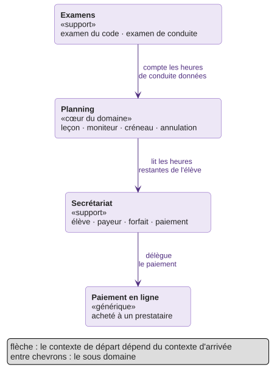

# Auto-école : la frise et les contextes, J2

Le code d'exemple du cours de Domain-Driven Design, Mastère 1, Ynov. Il reprend
l'auto-école du cours de la séance 3 : la même frise, les mêmes contextes, les mêmes mots.

Cette branche, `j2`, part du modèle du J1 (branche `main`) et montre ce que deviennent
dans le code l'event storming et les bounded contexts. Les couches, les repositories et
les tests viendront avec le J3.

## Les bounded contexts, un package chacun



| Contexte | Package | Ce qu'il contient |
|---|---|---|
| Secrétariat | `secretariat` | l'élève, ses heures achetées et décomptées |
| Planning | `planning` | la leçon, le moniteur, le créneau |
| Examens | `exams` | l'examen du code, les heures de conduite, l'examen de conduite |
| ce que les trois partagent | `shared` | l'identité de l'élève, son nom, ce qu'est un événement |
| les flèches de la context map | `contextmap` | une classe par flèche : la traduction entre deux contextes |

Le J1 rangeait un package par aggregate ; le J2 range ces packages dans leur contexte :
`planning.lesson`, `planning.instructor`, `secretariat.student`, `exams.student`.

**Deux classes `Student`.** L'élève existe au secrétariat et aux examens, avec la même
identité, `StudentId`, mais pas le même modèle : au secrétariat, un nom et des heures
achetées ; aux examens, le code, les heures de conduite, la présentation. Au planning,
il n'est qu'un identifiant. **Le mot « heure »** change aussi de sens : `Hours`, les
heures achetées, au secrétariat ; `DrivingHours`, les heures de conduite données, aux
examens ; au planning, c'est la leçon elle-même.

## La frise dans le code

| Post-it | Dans le code | Exemple |
|---|---|---|
| événement, orange | un record au passé, dans le package de son contexte | `LessonBooked` |
| commande, bleu | une méthode de la racine, à l'infinitif | `Lesson.cancel` |
| acteur, jaune | celui qui appelle la commande, ici `Main` | l'élève, le moniteur |
| règle devant un événement | la méthode refuse, et l'événement n'a pas lieu | R1, R2, les vingt heures |
| point chaud, rose | un commentaire `Hot spot` : la question reste posée au métier | dans `Lesson.cancel` |
| un événement qui en suit un autre | une traduction, dans `contextmap` | « Leçon réservée », puis « Heure décomptée » |

Chaque racine hérite d'`AggregateRoot` : ses commandes enregistrent leurs événements,
et celui qui a lancé la commande les récupère par `pullEvents()`.

| Événement de la frise | Contexte | Dans le code |
|---|---|---|
| Élève inscrit | Secrétariat | `StudentRegistered` |
| Heures achetées | Secrétariat | `HoursPurchased` |
| Paiement reçu | Paiement en ligne | rien : un sous-domaine générique, acheté à un prestataire |
| Heure décomptée | Secrétariat | `HourUsed` |
| Examen du code réussi | Examens | `TheoryExamPassed` |
| Leçon réservée | Planning | `LessonBooked` |
| Leçon annulée | Planning | `LessonCancelled` |
| Leçon due, car annulée moins de 48 heures avant | Planning | `LessonDue` |
| Leçon donnée | Planning | `LessonGiven` |
| Vingt heures de conduite atteintes | Examens | `TwentyDrivingHoursReached` |
| Élève présenté à l'examen de conduite | Examens | `PresentedToDrivingExam` |
| Permis obtenu | Examens | `LicenceObtained` |

## Lancer

Java 21 ou plus, sans outil de build : le code est dans `src/`. `Main` déroule la frise
de gauche à droite : à chaque ligne, l'acteur, la commande, les événements, puis ce
qu'en font les autres contextes. Il essaie aussi ce que le métier interdit.

```bash
javac -d out $(find src -name "*.java")
java -cp out fr.ynov.autoecole.Main
```

Sous Windows, en PowerShell :

```powershell
javac -d out (Get-ChildItem -Recurse src -Filter *.java).FullName
java -cp out fr.ynov.autoecole.Main
```
