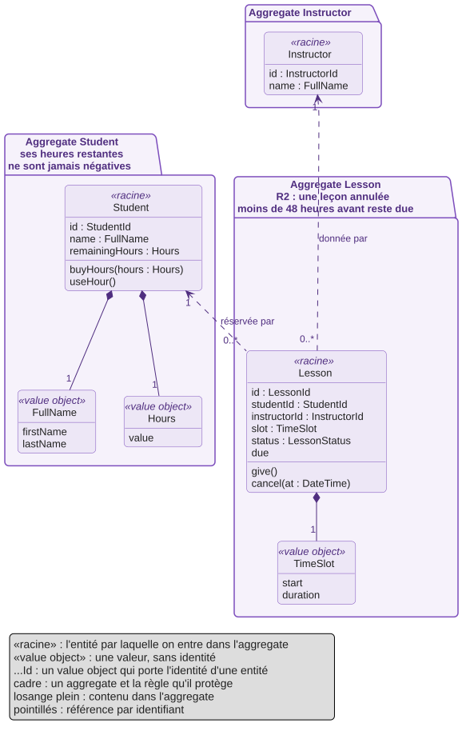

# Auto-école : le modèle du domaine, J1

Le code d'exemple du cours de Domain-Driven Design, Mastère 1, Ynov. Il reprend le modèle
de l'auto-école construit dans le cours de la séance 1 : les mêmes noms, les mêmes règles,
le même code.

Cette version s'arrête au **J1** : les entités, les value objects et les aggregates. Les
services du domaine, les repositories et les tests viendront avec le J3.

## Le modèle



| Aggregate | Racine | Ce qu'il contient | La règle qu'il protège |
|---|---|---|---|
| `student` | `Student` | `FullName`, `Hours` | ses heures restantes ne sont jamais négatives |
| `lesson` | `Lesson` | `TimeSlot`, `LessonStatus` | R2 : une leçon annulée moins de 48 heures avant reste due |
| `instructor` | `Instructor` | `FullName` | pas encore de règle |

Un package par aggregate, dans `src/fr/ynov/autoecole`. Les value objects partagés, `FullName` et `Hours`, sont dans
`shared`. Chaque identifiant est un value object : `StudentId`, `LessonId`,
`InstructorId`. Une leçon connaît l'élève et le moniteur par leurs identifiants, jamais
par les objets.

## Du glossaire au code

| Terme du glossaire | Dans le code |
|---|---|
| Élève | `Student` |
| Moniteur | `Instructor` |
| Leçon | `Lesson` |
| Heures | `Hours` |
| Créneau | `TimeSlot` |
| Nom | `FullName` |
| Acheter des heures | `Student.buyHours` |
| Décompter une heure | `Student.useHour` |
| Donner une leçon | `Lesson.give` |
| Annuler une leçon | `Lesson.cancel` |

Réserver une leçon (`reserveLesson`) touche deux aggregates, l'élève et la leçon : on
verra au J3 où la placer.

## Lancer

Java 21 ou plus, sans outil de build : le code est dans `src/`. `Main` met les règles à
l'épreuve : il essaie ce que le métier autorise et ce qu'il interdit, et affiche la
réponse du modèle.

```bash
javac -d out $(find src -name "*.java")
java -cp out fr.ynov.autoecole.Main
```

Sous Windows, en PowerShell :

```powershell
javac -d out (Get-ChildItem -Recurse src -Filter *.java).FullName
java -cp out fr.ynov.autoecole.Main
```

Dans IntelliJ IDEA : ouvrir le dossier, marquer `src` comme dossier de sources, puis
lancer `Main`.
